<!--
  MOGAMMAT ZUHAYR SMITH  /  GITHUB PROFILE
  Design system: black #08090B | white #F7F7FA | crimson #DC143C
  This profile is built with GitHub-compatible Markdown/HTML and local image assets.
  Upload the README.md and the assets/ folder together.
-->

  <a href="https://msmithfolio.netlify.app/">
    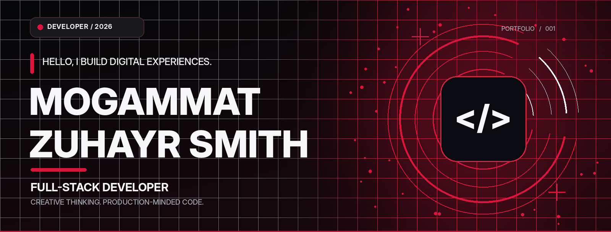
  </a>

   
   

  
  &nbsp;
  
  &nbsp;
  

   
   

  <b>DESIGN-LED THINKING &nbsp; • &nbsp; CLEAN ENGINEERING &nbsp; • &nbsp; REAL-WORLD DELIVERY</b>

 

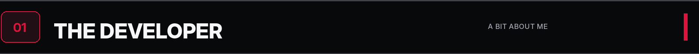

 

<table>
  <tr>
    <td width="64%" valign="top">
      <h3>I'm Mogammat Zuhayr Smith.</h3>
      
A <b>CodeSpace Academy graduate</b> and full-stack software developer who enjoys turning ambitious ideas into refined, practical products. I work across modern web interfaces, backend systems, integrations, and deployment — with a strong eye for UI/UX.

      
I care about the details: how a page feels, how a system works, and how the finished product performs beyond the first impression.

    </td>
    <td width="36%" valign="top">
      <h3>AT A GLANCE</h3>
      
◆ &nbsp; Full-stack development

      
◈ &nbsp; Design-minded interfaces

      
⌘ &nbsp; Production web applications

      
↗ &nbsp; Constantly building & learning

    </td>
  </tr>
</table>

 

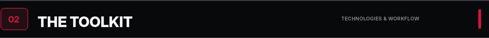

 

<table>
<tr>
  <td width="33%" valign="top">
    <h3>FRONTEND</h3>
    
    
    
    
    
    
    
    
  </td>
  <td width="34%" valign="top">
    <h3>BACKEND &amp; DATA</h3>
    
    
    
    
    
    
  </td>
  <td width="33%" valign="top">
    <h3>TOOLS &amp; DELIVERY</h3>
    
    
    
    
    
    
  </td>
</tr>
</table>

 

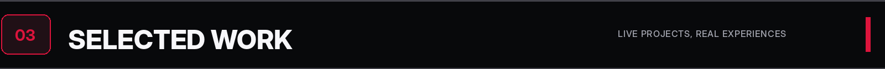

 

<table>
  <tr>
    <td width="50%" valign="top">
      <a href="https://kmgmt.co.za">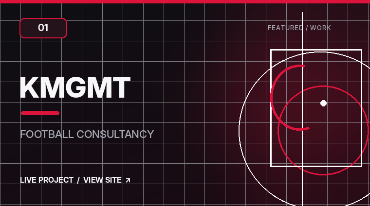</a>
      <h3>KMGMT</h3>
      
Football consultancy platform featuring player profiles, career guidance, and online consultation bookings.

      
    </td>
    <td width="50%" valign="top">
      <a href="https://ace.radio">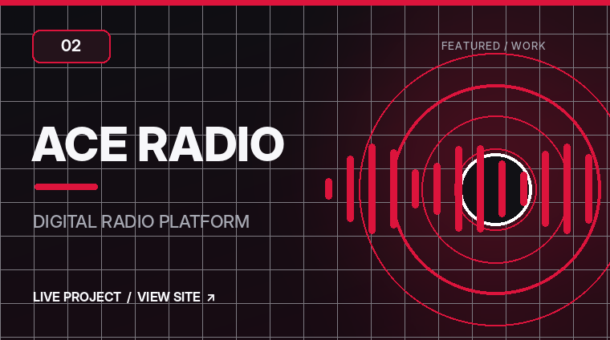</a>
      <h3>ACE RADIO</h3>
      
Live radio streaming, show schedules, presenter content, and a seamless listener experience across web and mobile.

      
    </td>
  </tr>
  <tr>
    <td width="50%" valign="top">
      <a href="https://marubymaru.co.za">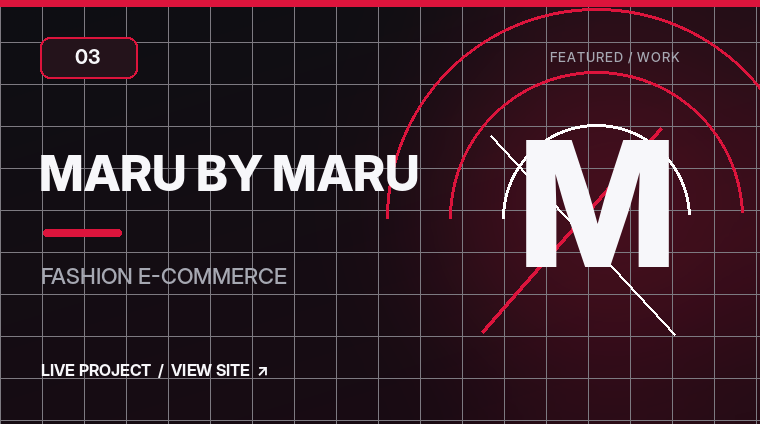</a>
      <h3>MARU BY MARU</h3>
      
Fashion e-commerce experience showcasing a signature dress collection and timeless brand aesthetic.

      
    </td>
    <td width="50%" valign="top">
      <a href="https://msmithfolio.netlify.app/">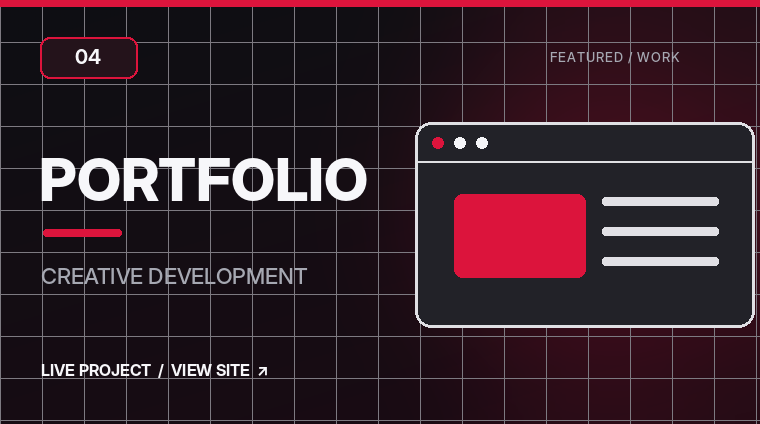</a>
      <h3>DEVELOPER PORTFOLIO</h3>
      
A personal showcase of projects, design decisions, and the development work behind real-world experiences.

      
    </td>
  </tr>
</table>

  

 

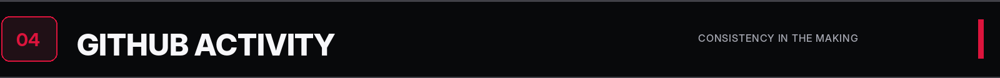

 

  
   
   
  
   
  Stats and activity visuals are provided by third-party GitHub README services.

 

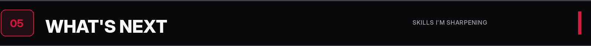

 

<table>
  <tr>
    <td width="50%" valign="top">
      <h3>↗ CURRENT FOCUS</h3>
      
React Native + Expo Advanced backend development API architecture &amp; database design

    </td>
    <td width="50%" valign="top">
      <h3>◈ HOW I WORK</h3>
      
Build for real users Pay attention to the details Learn, iterate, and keep shipping

    </td>
  </tr>
</table>

 

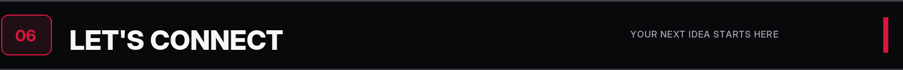

 

  <a href="https://msmithfolio.netlify.app/">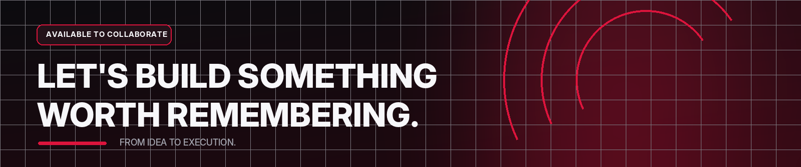</a>
   
   
  
  &nbsp;
  
   
   
  DESIGNED WITH INTENTION &nbsp; / &nbsp; DEVELOPED WITH PRECISION &nbsp; / &nbsp; BUILT TO LAST.

